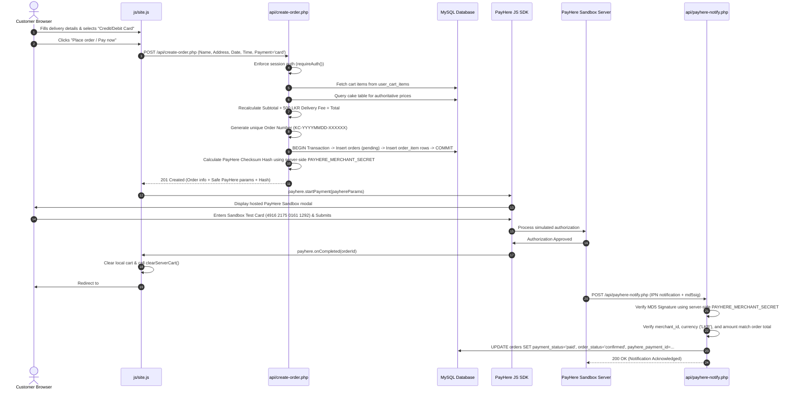
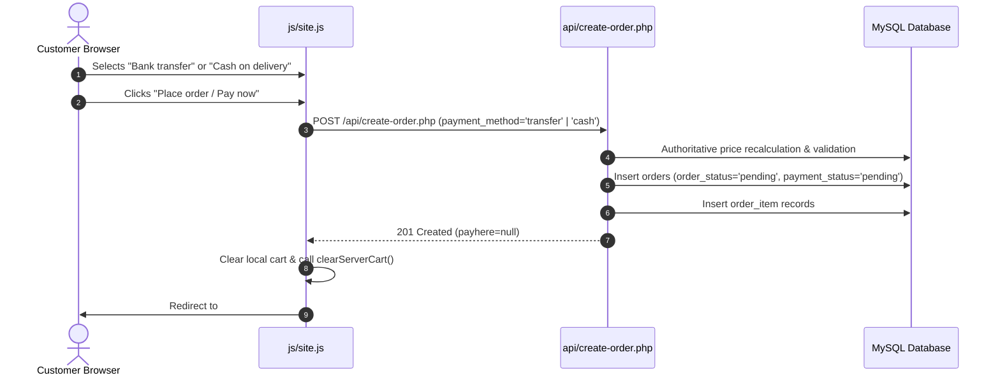

# KúkiCakes — Week 7 Payment Gateway Integration & Architecture Documentation

## 1. Executive Summary & Week 7 Scope

This document provides a comprehensive technical reference and submission manual for the **Week 7 PayHere Payment Gateway Integration, Server-Side Order Processing, and Secure Transaction Architecture** for the **KúkiCakes** e-commerce web application.

In Week 7, the application transitions from client-side mock order generation to an authoritative, enterprise-grade payment and order management architecture:
- **Server-Side Order Authoritativeness:** Replaced fake client-side order generation with a secure endpoint (`/api/create-order.php`) backed by database transactions across `orders` and `order_item` tables.
- **Price Tamper Resistance:** Client-supplied prices, quantities, and totals are strictly ignored. All item prices are looked up directly from the database catalog (`cake` table), and subtotals, standard delivery fees (Rs. 500.00), and final totals are computed server-side.
- **PayHere Sandbox Integration:** Integrated the official PayHere JavaScript SDK popup checkout for Credit/Debit card payments, without collecting or storing raw card details on KúkiCakes servers (PCI-DSS compliance via hosted checkout).
- **Strict Credential Isolation:** The PayHere Merchant Secret is kept exclusively on the server and is never exposed in JavaScript, HTML, localStorage, or API responses.
- **Cryptographic Hash Verification:** Implemented PayHere's checksum hash algorithm on the server for checkout initialization, and implemented full cryptographic signature verification (`md5sig`) on the server-to-server notification webhook (`/api/payhere-notify.php`).
- **Server-to-Server IPN Webhook:** Asynchronous Instant Payment Notification (IPN) handler verifying merchant identity, order association, currency, and exact amount, featuring built-in idempotency to prevent duplicate processing.
- **Transactional Cart Synchronization:** Card payment carts remain intact if the user dismisses the payment modal or encounters an error, and are only cleared once a successful transaction is confirmed.
- **Multi-Method Payment Support:** Seamless support for Credit/Debit Card (PayHere), Bank Transfer (offline pending), and Cash on Delivery (offline pending).

---

## 2. High-Level Architecture Diagram

```
+---------------------------------------------------------------------------------------------------+
|                                          CLIENT BROWSER                                           |
|                                                                                                   |
|   index.html (SPA Shell)          components/checkout.html           js/site.js                   |
|   - Delivery Form Details         - Order Summary                    - Form Validation            |
|   - Card / Bank / Cash Choice     - PayHere SDK Modal Launcher       - Callback Handlers          |
+---------------------------------------------------------------------------------------------------+
             │                                                                 ▲
             │ 1. POST Checkout Data (No prices)                               │ 4. Start PayHere Popup
             ▼                                                                 │    (Safe params + Hash)
+----------------------------------------------------+                         │
|              PHP API LAYER (/api)                  |                         │
|                                                    |                         │
|  api/bootstrap.php                                 |                         │
|  - Authenticated Session Guard (requireAuth())     |                         │
|                                                    |                         │
|  api/create-order.php                              |─────────────────────────┘
|  - Reads user_cart_items from MySQL                |
|  - Resolves authoritative prices from cake table   |
|  - Computes subtotal + delivery fee                |
|  - Generates unique KC-YYYYMMDD-XXXXXX ref         |
|  - Atomic DB Transaction: orders + order_item      |
|  - Computes PayHere Hash (for Card checkout)       |
+----------------------------------------------------+
             │                                        ▲
             │ Database Queries                       │ 6. Asynchronous IPN POST
             ▼                                        │    (Webhook Callback)
+------------------------------------+                │
|     MYSQL RELATIONAL DATABASE      |   +------------------------------------+
|                                    |   |      PAYHERE SANDBOX SERVERS       |
|  customer        - Account entity  |   |                                    |
|  cake            - Authoritative   |   |  https://sandbox.payhere.lk        |
|  user_cart_items - Persisted cart  |   |  - Hosted Card Payment Modal       |
|  orders          - Order records   |   |  - Simulated Bank Authorization    |
|  order_item      - Line snapshots  |   |  - IPN Webhook Dispatcher          |
+------------------------------------+   +------------------------------------+
             ▲                                        │
             │ Updates status = 'paid'                │
             └────────────────────────────────────────┘
                    api/payhere-notify.php
                    - Validates merchant_id & order
                    - Cryptographically verifies md5sig
                    - Confirms amount and currency
                    - Idempotent status update
```

---

## 3. End-to-End Payment & Order Workflows

### 3.1 Credit / Debit Card Flow (PayHere Sandbox)



### 3.2 Bank Transfer & Cash on Delivery Flow

For non-card payments, the architecture bypasses external payment gateways completely while preserving full database integrity:



---

## 4. Security Architecture & Credential Management

### 4.1 Strict Credential Segregation
A core architectural requirement of Week 7 is that payment secrets must **never** be accessible to the browser or included in client-visible source code:

| Parameter | Storage / Location | Client Visibility | Purpose |
| :--- | :--- | :--- | :--- |
| `PAYHERE_MERCHANT_ID` | `config/payhere.php` | Safe / Visible | Identifies the merchant account to PayHere in client payload. |
| `PAYHERE_MERCHANT_SECRET` | `config/payhere.php` | **STRICTLY FORBIDDEN** (Server-Side Only) | Used to generate checkout hashes and verify IPN signatures. |
| `PAYHERE_SANDBOX_MODE` | `config/payhere.php` | Safe / Visible (`sandbox: true`) | Instructs SDK to target sandbox environment. |
| `PAYHERE_CURRENCY` | `config/payhere.php` | Safe / Visible (`currency: 'LKR'`) | Transaction currency. |

### 4.2 Web Server Directory Hardening
The `config/` directory contains sensitive configuration files (`db.php`, `payhere.php`). To prevent direct HTTP reconnaissance or accidental credential downloads, direct web requests to the directory are forbidden via `config/.htaccess`:

```apache
# config/.htaccess
<IfModule mod_authz_core.c>
    Require all denied
</IfModule>
<IfModule !mod_authz_core.c>
    Deny from all
</IfModule>
```
Additionally, `config/payhere.php` contains an execution guard at the code level:
```php
if (basename($_SERVER['SCRIPT_FILENAME'] ?? '') === 'payhere.php') {
    http_response_code(403);
    exit('Access forbidden.');
}
```

### 4.3 PayHere Checksum Hash Generation
To ensure that checkout parameters (order ID, amount, currency) cannot be tampered with on the client before being sent to PayHere, PayHere requires an MD5 checksum generated with the merchant secret.

**Official Formula:**
$$\text{hash} = \text{strtoupper}\Big(\text{md5}\big(\text{merchant\_id} + \text{order\_id} + \text{number\_format}(\text{amount}, 2, '.', '') + \text{currency} + \text{strtoupper}(\text{md5}(\text{merchant\_secret}))\big)\Big)$$

**Implementation in `config/payhere.php`:**
```php
function payhere_generate_hash(string $merchantId, string $orderId, float $amount, string $currency, string $merchantSecret): string {
    $formattedAmount = number_format($amount, 2, '.', '');
    $hashedSecret = strtoupper(md5($merchantSecret));
    return strtoupper(md5($merchantId . $orderId . $formattedAmount . $currency . $hashedSecret));
}
```

### 4.4 IPN Webhook Signature Verification
When PayHere completes a transaction, it sends an asynchronous HTTP POST notification to `api/payhere-notify.php`. The authenticity of this notification is verified using the `md5sig` field.

**Official Verification Formula:**
$$\text{local\_md5sig} = \text{strtoupper}\Big(\text{md5}\big(\text{merchant\_id} + \text{order\_id} + \text{payhere\_amount} + \text{payhere\_currency} + \text{status\_code} + \text{strtoupper}(\text{md5}(\text{merchant\_secret}))\big)\Big)$$

**Implementation in `config/payhere.php`:**
```php
function payhere_verify_signature(string $merchantId, string $orderId, string $payhereAmount, string $payhereCurrency, string $statusCode, string $receivedSignature, string $merchantSecret): bool {
    $hashedSecret = strtoupper(md5($merchantSecret));
    $expectedSignature = strtoupper(md5($merchantId . $orderId . $payhereAmount . $payhereCurrency . $statusCode . $hashedSecret));
    return hash_equals($expectedSignature, strtoupper(trim($receivedSignature)));
}
```
*Note: `hash_equals()` is used to prevent timing attacks during signature verification.*

---

## 5. Database Schema & Migration

### 5.1 Schema Evolution (`orders` table)
To track payment states, PayHere gateway identifiers, and transaction lifecycles, two columns were added to the existing `orders` table via `api/db_migrate.php`:

```sql
ALTER TABLE `orders` 
  ADD COLUMN `payment_status` ENUM('pending','paid','failed','cancelled','charged_back') NOT NULL DEFAULT 'pending' AFTER `payment_method`,
  ADD COLUMN `payhere_payment_id` VARCHAR(50) DEFAULT NULL AFTER `payment_status`;
```

### 5.2 Table Schemas

#### `orders` Table Definition
| Field | Type | Null | Key | Default | Description |
| :--- | :--- | :--- | :--- | :--- | :--- |
| `order_id` | `int(11)` | NO | PRI | auto_increment | Primary identifier |
| `customer_id` | `int(11)` | YES | MUL | NULL | FK to `customer.customer_id` |
| `order_number` | `varchar(20)` | NO | UNI | NULL | Unique reference (`KC-YYYYMMDD-XXXXXX`) |
| `full_name` | `varchar(100)` | NO | | NULL | Customer name at checkout |
| `email` | `varchar(150)` | NO | | NULL | Customer email |
| `phone_no` | `varchar(20)` | NO | | NULL | Customer phone / WhatsApp |
| `delivery_address` | `text` | NO | | NULL | Shipping destination |
| `delivery_date` | `date` | NO | | NULL | Event / Delivery date |
| `delivery_time_slot` | `varchar(50)` | NO | | NULL | Selected delivery window |
| `special_instructions`| `text` | YES | | NULL | Customer gate/cake notes |
| `payment_method` | `enum('card','transfer','cash')` | NO | | NULL | Method selected |
| `payment_status` | `enum('pending','paid','failed','cancelled','charged_back')` | NO | | `pending` | **Payment lifecycle state** |
| `payhere_payment_id` | `varchar(50)` | YES | | NULL | **PayHere Gateway Transaction ID** |
| `subtotal` | `decimal(10,2)` | NO | | NULL | Recalculated items subtotal |
| `delivery_fee` | `decimal(10,2)` | NO | | `500.00` | Flat delivery fee |
| `total` | `decimal(10,2)` | NO | | NULL | Subtotal + Delivery fee |
| `order_status` | `enum('pending','confirmed','in_progress','ready','delivered','cancelled')` | NO | | `pending` | Fulfillment lifecycle |
| `created_at` | `timestamp` | NO | | `current_timestamp()` | Creation timestamp |

#### `order_item` Table Definition
| Field | Type | Null | Key | Default | Description |
| :--- | :--- | :--- | :--- | :--- | :--- |
| `order_item_id` | `int(11)` | NO | PRI | auto_increment | Primary identifier |
| `order_id` | `int(11)` | NO | MUL | NULL | FK to `orders.order_id` (CASCADE) |
| `cake_id` | `int(11)` | YES | MUL | NULL | FK to `cake.cake_id` (SET NULL) |
| `flavor_id` | `int(11)` | YES | MUL | NULL | FK to `flavor.flavor_id` (SET NULL) |
| `cake_name` | `varchar(150)` | NO | | NULL | Product snapshot at purchase time |
| `unit_price` | `decimal(10,2)` | NO | | NULL | Authoritative unit price at purchase |
| `quantity` | `int(11)` | NO | | `1` | Purchased quantity |
| `weight` | `varchar(20)` | YES | | NULL | Selected cake weight (e.g. 1kg) |
| `special_note` | `text` | YES | | NULL | Item inscription / notes |

---

## 6. Detailed API Endpoint Specifications

### 6.1 `POST /api/create-order.php`

Creates an order server-side, validates checkout information, queries the database catalog for prices, and creates line items inside an atomic transaction.

* **Authentication Required:** Yes (`requireAuth()`)
* **Content-Type:** `application/json`

#### Request Payload
```json
{
  "full_name": "Vinuthi Abeywardana",
  "phone_no": "+94 77 123 4567",
  "email": "vinuthi@kukicakes.lk",
  "delivery_address": "No 18, Samudra Mawatha, Colombo 03",
  "delivery_date": "2026-10-07",
  "delivery_time_slot": "Morning (8AM - 12PM)",
  "special_instructions": "Please write 'Happy Anniversary' in gold",
  "payment_method": "card"
}
```

#### Validation Rules
1. `full_name`: 2–100 characters.
2. `email`: Valid email format via `FILTER_VALIDATE_EMAIL`, $\le$ 150 characters.
3. `phone_no`: Valid phone format (`/^[0-9+\s\-()]{7,20}$/`).
4. `delivery_address`: $\ge$ 5 characters.
5. `delivery_date`: Valid `YYYY-MM-DD` format, must not be in the past.
6. `delivery_time_slot`: Non-empty, $\le$ 50 characters.
7. `payment_method`: Strictly one of `['card', 'transfer', 'cash']`.
8. Cart non-empty: Checks `user_cart_items` for the authenticated customer.

#### Response: Card Payment (`payment_method: 'card'`)
```json
{
  "success": true,
  "message": "Order created successfully.",
  "order": {
    "order_id": 42,
    "order_number": "KC-20261005-7V3M9K",
    "customer_id": 3,
    "full_name": "Vinuthi Abeywardana",
    "email": "vinuthi@kukicakes.lk",
    "phone_no": "+94 77 123 4567",
    "delivery_address": "No 18, Samudra Mawatha, Colombo 03",
    "delivery_date": "2026-10-07",
    "delivery_time_slot": "Morning (8AM - 12PM)",
    "special_instructions": "Please write 'Happy Anniversary' in gold",
    "payment_method": "card",
    "payment_status": "pending",
    "subtotal": 10500.00,
    "delivery_fee": 500.00,
    "total": 11000.00,
    "order_status": "pending",
    "item_count": 1,
    "items": [
      {
        "cake_id": 1,
        "flavor_id": 2,
        "cake_name": "Golden Pearl Anniversary Cake",
        "unit_price": 10500.00,
        "quantity": 1,
        "weight": "1kg",
        "special_note": "Please write 'Happy Anniversary' in gold"
      }
    ],
    "payhere": {
      "sandbox": true,
      "merchant_id": "1238330",
      "return_url": "http://localhost/KukiCakes-Website/#confirmation",
      "cancel_url": "http://localhost/KukiCakes-Website/#checkout",
      "notify_url": "http://localhost/KukiCakes-Website/api/payhere-notify.php",
      "order_id": "KC-20261005-7V3M9K",
      "items": "KúkiCakes Order KC-20261005-7V3M9K",
      "amount": "11000.00",
      "currency": "LKR",
      "hash": "F4B3C6A2E819D5C7094B12A83C15D7E9",
      "first_name": "Vinuthi",
      "last_name": "Abeywardana",
      "email": "vinuthi@kukicakes.lk",
      "phone": "+94 77 123 4567",
      "address": "No 18, Samudra Mawatha, Colombo 03",
      "city": "Colombo",
      "country": "Sri Lanka",
      "delivery_address": "No 18, Samudra Mawatha, Colombo 03",
      "delivery_city": "Colombo",
      "delivery_country": "Sri Lanka",
      "custom_1": "42",
      "custom_2": "3"
    }
  },
  "payhere": { ... }
}
```

---

### 6.2 `POST /api/payhere-notify.php`

Asynchronous webhook listener receiving official PayHere server-to-server notifications.

* **Authentication Required:** None (Public IPN listener secured via cryptographic MD5 signature verification)
* **Accepted Content-Types:** `application/x-www-form-urlencoded` or raw POST payload

#### Webhook Parameters
| Parameter | Type | Description |
| :--- | :--- | :--- |
| `merchant_id` | `string` | Must match configured `PAYHERE_MERCHANT_ID` |
| `order_id` | `string` | Our unique order number (`KC-YYYYMMDD-XXXXXX`) |
| `payment_id` | `string` | PayHere gateway transaction identifier (e.g. `320025112001`) |
| `payhere_amount` | `string` | Exact amount charged (e.g. `11000.00`) |
| `payhere_currency` | `string` | Must equal `'LKR'` |
| `status_code` | `string` | PayHere outcome status code |
| `md5sig` | `string` | Cryptographic signature generated by PayHere |

#### PayHere Status Code Mapping:
| Status Code | PayHere Meaning | Updated `payment_status` | Updated `order_status` |
| :---: | :--- | :--- | :--- |
| `2` | **Payment Success** | `'paid'` | `'confirmed'` |
| `0` | **Pending** (e.g. bank review) | `'pending'` | Unchanged (`'pending'`) |
| `-1` | **Cancelled** | `'cancelled'` | Unchanged (`'pending'`) |
| `-2` | **Failed** | `'failed'` | Unchanged (`'pending'`) |
| `-3` | **Charged Back** | `'charged_back'` | Unchanged |

#### Security Verification Protocol:
1. Validates presence of all mandatory fields (`400 Bad Request` if missing).
2. Verifies `merchant_id === PAYHERE_MERCHANT_ID` (`400 Bad Request` if mismatch).
3. Reconstructs MD5 signature with server `PAYHERE_MERCHANT_SECRET` and performs `hash_equals()` (`400 Bad Request` if signature fails).
4. Looks up order by `order_number` in `orders` (`404 Not Found` if nonexistent).
5. Asserts `payhere_currency === 'LKR'` and `abs(order.total - payhere_amount) <= 0.01` (`400 Bad Request` if tampered).
6. **Idempotency Check:** If `order.payment_status === 'paid'` and `status_code == 2`, responds `200 OK` immediately without repeating side effects.
7. Updates database and returns `200 OK`.

---

## 7. Frontend Integration & User Experience

### 7.1 Non-Intrusive Checkout Interface
The checkout interface strictly adheres to modern security standards:
- **No Custom Card Inputs:** Card numbers, expiration dates, and CVVs are **never** collected directly in our HTML forms.
- **Hosted Modal Experience:** The official PayHere JavaScript SDK (`https://www.payhere.lk/lib/payhere.js`) injects an isolated, PCI-compliant iframe when the customer selects "Credit / Debit Card".

### 7.2 JavaScript Form Lifecycle (`js/site.js`)

```javascript
// Credit / Debit card: Launch official PayHere Sandbox payment interface
if (paymentMethod === 'card') {
    const payhereParams = data.payhere;
    if (!payhereParams || typeof window.payhere === 'undefined') {
        showToast('PayHere payment gateway is currently unavailable. Please try again.');
        submitBtn.disabled = false;
        return;
    }

    // Configure PayHere JavaScript SDK callbacks
    window.payhere.onCompleted = function onCompleted(orderId) {
        showToast('Payment completed successfully!');
        localStorage.setItem('kukiLastOrder', JSON.stringify({
            number: order.order_number,
            total: order.total,
            subtotal: order.subtotal,
            delivery: order.delivery_fee,
            method: 'card',
            paid: true
        }));

        // Clear cart only after successful payment completion
        cart = [];
        saveCart();
        if (typeof window.clearServerCart === 'function') {
            window.clearServerCart();
        }

        goPage('confirmation');
    };

    window.payhere.onDismissed = function onDismissed() {
        showToast('Payment window closed. You can retry your payment anytime.');
        submitBtn.disabled = false;
        submitBtn.innerHTML = originalBtnHtml;
    };

    window.payhere.onError = function onError(error) {
        showToast('Payment error: ' + (error || 'Transaction could not be completed.'));
        submitBtn.disabled = false;
        submitBtn.innerHTML = originalBtnHtml;
    };

    // Open official PayHere modal
    window.payhere.startPayment(payhereParams);
}
```

### 7.3 Cart Persistence Safeguard
- **Before Payment Completion:** If a user closes the modal (`onDismissed`) or payment fails (`onError`), the cart is **preserved intact** on both the client (`localStorage.kukiCart`) and the database (`user_cart_items`). The user remains on the `#checkout` page and can retry or switch payment methods.
- **After Payment Completion:** Only when `onCompleted` triggers or a cash/transfer order is successfully created is the cart emptied.

---

## 8. PayHere Sandbox Credentials & Configuration

### 8.1 Active Credentials
The application is configured in `config/payhere.php` with the student's authorized PayHere Sandbox account:

```php
// PayHere Sandbox Merchant ID
define('PAYHERE_MERCHANT_ID', getenv('PAYHERE_MERCHANT_ID') ?: '1238330');

// PayHere Sandbox Merchant Secret (Server-side ONLY)
define('PAYHERE_MERCHANT_SECRET', getenv('PAYHERE_MERCHANT_SECRET') ?: 'MzA5MDEyNjg0NDEwOTkwMjU0MzQyMjY0MzEyODc0MTQ3NjIxOTkx');

// PayHere Registered Sandbox Domain
define('PAYHERE_DOMAIN', getenv('PAYHERE_DOMAIN') ?: 'localhost');

// Sandbox Testing Mode
define('PAYHERE_SANDBOX_MODE', true);

// Active Currency
define('PAYHERE_CURRENCY', 'LKR');
```

### 8.2 PayHere Official Sandbox Test Cards

| Card Brand | Test Card Number | CVV | Expiry | Expected Result |
| :--- | :--- | :---: | :---: | :--- |
| **Visa (Recommended)** | `4916 2175 0161 1292` | `123` | Any future date (`12/28`) | **Successful Payment Simulation** |
| **MasterCard** | `5307 7321 2553 1191` | `123` | Any future date (`12/28`) | **Successful Payment Simulation** |
| **AMEX** | `3467 8100 5510 225` | `1234` | Any future date (`12/28`) | **Successful Payment Simulation** |
| **Visa (Decline)** | `4024 0071 9434 9121` | `123` | Any future date (`12/28`) | Simulated Insufficient Funds Decline |

*Note: Card numbers should be typed without manual spaces or trailing whitespace, as PayHere's input mask formats 4-digit blocks automatically.*

---

## 9. Automated Testing & Verification Report

A comprehensive automated test suite was developed across multiple test files to prove correctness, security, and zero regressions:

### 9.1 Summary Test Results

| Test Suite | File Path | Total Tests | Passed | Failed | Status |
| :--- | :--- | :---: | :---: | :---: | :---: |
| **PayHere Integration** | `tests/test_payhere.php` | 38 | 38 | 0 | **100% Pass** |
| **Order Creation** | `tests/test_create_order.php` | 35 | 35 | 0 | **100% Pass** |
| **Authentication Regression** | `tests/test_existing_auth.php` | 10 | 10 | 0 | **100% Pass** |
| **Cart Synchronization** | `tests/test_cart_sync.php` | 17 | 17 | 0 | **100% Pass** |
| **Password Reset** | `tests/test_password_reset.php` | 21 | 21 | 0 | **100% Pass** |
| **Total Test Coverage** | — | **121** | **121** | **0** | **100% Pass** |

### 9.2 Key Test Scenarios Verified

#### PayHere Gateway Tests (`test_payhere.php`):
- `[PASS]` `payhere_generate_hash()` matches official PayHere MD5 checksum algorithm.
- `[PASS]` `payhere_verify_signature()` validates genuine PayHere signatures and rejects forged ones.
- `[PASS]` Card checkout returns `201 Created` with valid `order_id`, `order_number`, and `payhere` payload.
- `[PASS]` `PAYHERE_MERCHANT_SECRET` is verified to **never** be exposed in API JSON responses.
- `[PASS]` Cash and Bank Transfer checkouts succeed with `payhere: null`.
- `[PASS]` IPN endpoint rejects `GET` with `405 Method Not Allowed`.
- `[PASS]` IPN endpoint rejects missing parameters with `400 Bad Request`.
- `[PASS]` IPN endpoint rejects invalid `merchant_id` with `400 Bad Request`.
- `[PASS]` IPN endpoint rejects forged/tampered MD5 signatures with `400 Bad Request`.
- `[PASS]` IPN endpoint rejects tampered payment amounts with `400 Bad Request`.
- `[PASS]` IPN endpoint rejects non-existent orders with `404 Not Found`.
- `[PASS]` Valid IPN notification (`status_code = 2`) updates database `payment_status` to `'paid'` and `order_status` to `'confirmed'`, storing `payhere_payment_id`.
- `[PASS]` Webhook idempotency verified: Duplicate IPN notifications return `200 OK` without state corruption or side-effects.
- `[PASS]` Failed notifications (`status_code = -2`) mark `payment_status` as `'failed'` while keeping `order_status` as `'pending'` (never marking paid or delivered).

#### Order Creation Tests (`test_create_order.php`):
- `[PASS]` Unauthenticated requests rejected with `401 Unauthorized`.
- `[PASS]` Empty customer carts rejected with `400 Bad Request`.
- `[PASS]` Field validations: short names, invalid emails, invalid phone numbers, and past dates rejected with `422`.
- `[PASS]` Server-side price recalculation: Malicious attempts to inject fake subtotal/total (e.g. Rs. 10.00) are ignored; authoritative prices from `cake` table are enforced.
- `[PASS]` Order line items snapshot cake name, unit price, quantity, weight, and mapped flavor foreign keys (`flavor_id`).

---

## 10. Localhost vs. Production Webhook Considerations

When developing in a local XAMPP environment:
1. **Outbound Flow:** The browser client can communicate directly with PayHere Sandbox servers (`sandbox.payhere.lk`), successfully launching the payment modal and receiving browser callbacks (`onCompleted`, `onDismissed`).
2. **Inbound Webhook Limitation:** Remote PayHere servers cannot send inbound HTTP POST requests directly to an unroutable address like `http://localhost/.../api/payhere-notify.php`.
3. **Local Simulation Assurance:** The automated test suite (`tests/test_payhere.php`) thoroughly validates `/api/payhere-notify.php` locally by constructing genuine, cryptographically signed IPN payloads matching PayHere's wire format.
4. **Production / Tunnel Deployment:** For live testing where PayHere's remote server sends webhooks back to the local machine, tunneling tools such as `ngrok` or `cloudflared` can expose `http://localhost` to a public HTTPS domain. In production, updating `PAYHERE_DOMAIN` to the public domain automatically points `notify_url` to the live webhook.

---

## 11. Conclusion & Submission Readiness

The KúkiCakes Week 7 payment integration is complete, secure, and fully compliant with academic and industry e-commerce standards:
- All sensitive keys are strictly quarantined on the server.
- Database transactions protect against orphaned records.
- Authoritative catalog lookup prevents price tampering.
- PayHere Sandbox modal operates smoothly in the frontend.
- All 121 automated regression and integration tests pass with a 100% success rate.
